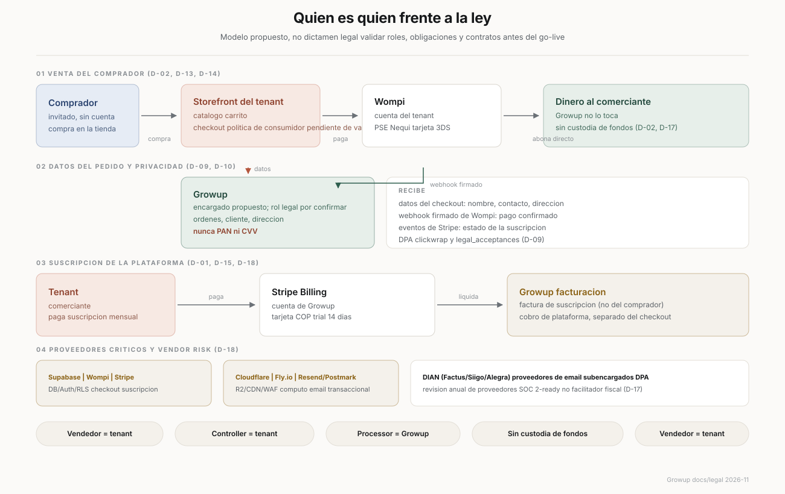
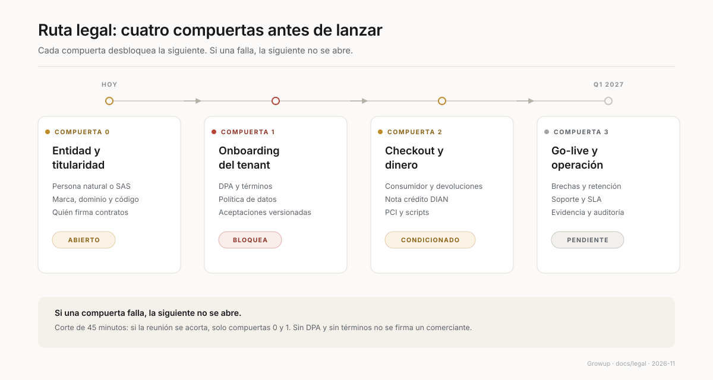
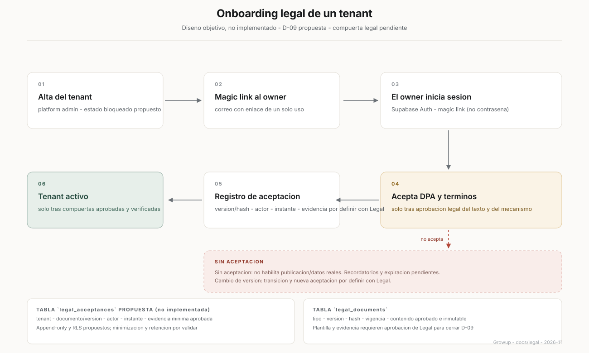
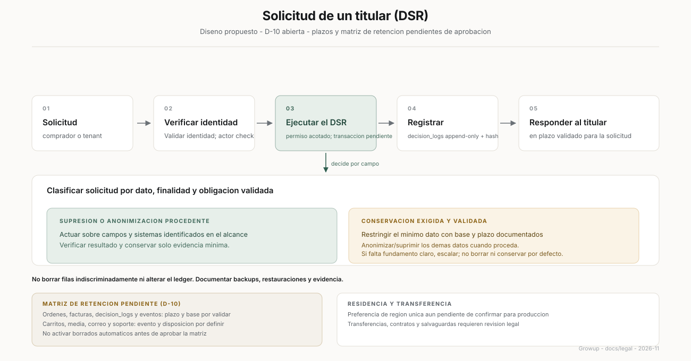
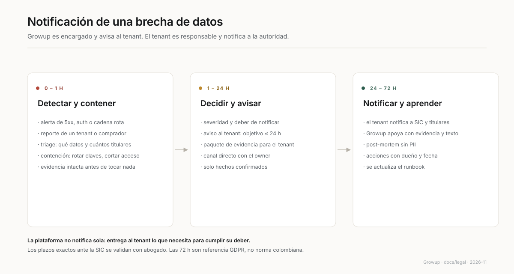

# Flujos legales

> **Estado:** diseño propuesto para revisión; no es una política aprobada ni evidencia de que los flujos estén implementados.
> D-09, D-10 y D-12 siguen abiertas. La decisión de posponer cambios funcionales se mantiene: ningún diagrama autoriza por sí solo el tratamiento de datos reales.

Diagramas de los cinco flujos que se discuten con el abogado. Todos son SVG editables, sin dependencias externas ni fuentes remotas: se ven igual en GitHub, en el navegador y en un PDF.

| Flujo | Pregunta que responde |
|---|---|
| [Reparto de roles](flujo-roles.svg) | ¿Quién vende, quién trata los datos y por dónde va el dinero? |
| [Ruta legal](flujo-ruta-legal.svg) | ¿En qué orden se cierran las decisiones y qué bloquea cada una? |
| [Onboarding legal](flujo-onboarding-legal.svg) | ¿Cómo acepta el DPA un comerciante y qué pasa si no acepta? |
| [Solicitud de un titular](flujo-dsr.svg) | ¿Qué se anonimiza y qué se conserva cuando alguien pide borrar sus datos? |
| [Brecha de datos](flujo-brecha.svg) | ¿Quién notifica, a quién y en qué plazo? |

Los diagramas son de diseño y algunos contienen plazos, referencias normativas o periodos de conservación que requieren validación legal. Hasta que se cierre la decisión correspondiente, esos valores son **pendientes**, no obligaciones confirmadas ni SLA vigente. El flujo técnico complementario está en [flujos de seguridad](../architecture/04-flujos-seguridad.md).

---

## 1. Reparto de roles



Tres líneas separadas: la venta del comprador, los datos del pedido y la suscripción de la plataforma. La decisión de producto asigna la venta y los fondos al comerciante y excluye custodia de Growup. La clasificación de responsable/encargado es el modelo operativo propuesto y debe confirmarse según contratos y operación real.

## 2. Ruta legal



Cada compuerta desbloquea la siguiente. Si la reunión se acorta a 45 minutos, solo se cubren las compuertas 0 y 1: sin DPA y sin términos no se puede firmar un comerciante.

## 3. Onboarding legal de un tenant



El diseño propuesto prevé `pending_legal`, aceptación del owner y registro versionado antes de publicar. No está implementado ni aprobado; evidencia, datos de red, cambios de versión y transición de estado siguen sujetos a D-09 y revisión legal.

## 4. Solicitud de un titular (DSR)



El diseño propone evaluar cada dato y documentar supresión, anonimización o conservación restringida. Qué datos se conservan y durante cuánto tiempo depende de la matriz D-10 aprobada; no se presume una retención fiscal uniforme.

## 5. Brecha de datos



El diseño separa la contención/evidencia de Growup de las decisiones de notificación del responsable. La obligación de Growup, los destinatarios y plazos dependen de la ley aplicable, los hechos y el contrato; D-12 continúa abierta y requiere revisión legal.

---

## Secuencia operativa propuesta

### A. Roles y límites del servicio

1. El comerciante configura y opera su tienda y mantiene su relación comercial con el comprador. La caracterización jurídica de responsable, encargado, vendedor y cualquier posible rol adicional debe confirmarse por contrato y por las actividades reales, no solo por una etiqueta en la UI.
2. Growup procesa datos para prestar el servicio bajo instrucciones documentadas, minimiza accesos y mantiene controles de seguridad. No se habilita uso secundario para publicidad ni custodia de fondos por inferencia.
3. Cada proveedor que procese datos se registra en el inventario de subencargados, con finalidad, datos/categorías, región, medidas, contrato y fecha de revisión. Su aprobación y el mecanismo de aviso/cambio quedan sujetos al DPA aprobado.

### B. Onboarding y aceptación del DPA (D-09, propuesta)

```text
Legal prepara y aprueba el texto
  → se publica documento inmutable con versión, hash y vigencia
  → platform admin crea tenant sin habilitar storefront/datos reales
  → owner autenticado ve el texto y sus condiciones
  → aceptación explícita vinculada a tenant + actor + versión exacta
  → se guarda evidencia mínima, append-only y verificable
  → compuerta de publicación verifica aceptación vigente + entitlement de billing
  → solo una política aprobada habilita el siguiente estado
```

- Rechazo, documento no vigente o fallo al guardar evidencia: no activar ni publicar; ofrecer salida/contacto y conservar el estado pendiente conforme a la política aprobada.
- La política de publicación verifica de forma independiente los documentos legales vigentes requeridos y el entitlement de la suscripción. Falta de aceptación o entitlement denegado bloquea publicación; `past_due`, periodo de gracia y suspensión siguen la política de billing aprobada, sin inventar un plazo en este flujo.
- La lista de documentos que requieren aceptación (DPA, términos u otros) y si un cambio exige nueva aceptación/aviso se define en el texto y la revisión legal.
- Una nueva versión no sobrescribe la aceptación anterior. La necesidad de nueva aceptación, aviso o periodo de transición debe estar definida por Legal.
- Campos probatorios, uso de IP/User-Agent, retención, texto y mecanismo de firma/clickwrap requieren aprobación legal. No almacenar una IP completa por defecto ni asumir que un hash simple la anonimiza.
- Este flujo no está activo ni debe usarse con datos reales hasta cerrar D-09 y completar las pruebas de publicación bloqueada.

### C. Solicitud de derechos del titular (DSR, D-10, propuesta)

```text
Recibir solicitud → registrar fecha/canal y alcance mínimo
  → verificar identidad y legitimación sin recopilar datos excesivos
  → ubicar responsable/tenant y los sistemas/subencargados pertinentes
  → clasificar cada categoría/campo: acceso, corrección, supresión u otra petición
  → validar excepciones y retención con matriz aprobada
  → ejecutar anonimización/supresión selectiva o documentar motivo de no ejecución
  → verificar resultado, registrar evidencia minimizada y responder por canal seguro
```

- No hacer borrado masivo ni alterar filas del ledger append-only. Preservar el mínimo estrictamente requerido cuando una obligación validada lo exija, aislarlo y restringir acceso; anonimizar los datos no necesarios.
- La matriz debe indicar por categoría la finalidad, base/obligación, responsable, plazo, evento de inicio, disposición final, backups y proveedores. El requisito actual del proyecto pide al menos 5 años para órdenes, facturas y `decision_logs`; Legal/Contabilidad deben validar su fundamento, alcance y cómputo antes de tratarlo como obligación legal o automatizar la retención.
- Ningún otro plazo de diagrama se considera aprobado hasta validar con abogado/contador y documentar excepciones.
- Un administrador con autorización específica no equivale a autorización general `service_role`. Toda ejecución debe ser aprobada, idempotente, transaccional cuando corresponda y auditada sin duplicar la PII.
- No prometer borrado instantáneo en backups; documentar ciclos de expiración y tratamiento de restauraciones para que un restore no reponga datos ya suprimidos.

### D. Incidente o brecha (D-12, propuesta)

```text
Detección/reporte → declarar incidente y preservar evidencia
  → contener acceso/credenciales y determinar alcance por tenant/datos
  → evaluación conjunta de seguridad + privacidad + asesoría
  → informar al tenant afectado por el canal acordado, con hechos confirmados
  → apoyar al responsable con evidencia y estado de contención
  → responsable legal define y ejecuta notificaciones externas aplicables
  → seguimiento, cierre y pruebas correctivas
```

- La respuesta técnica de Growup (detección, contención, evidencia y soporte al tenant) se separa de la decisión jurídica de notificar a titulares o autoridades. No se declara que Growup nunca tenga un deber legal propio: eso se determina por los hechos, el contrato y la asesoría.
- Un objetivo interno/contractual de aviso rápido al tenant debe fijarse en D-12 y el DPA. No confundirlo con un plazo legal para la SIC u otra autoridad.
- Preparar canales de guardia y plantillas antes de producción. Toda comunicación identifica hechos confirmados, alcance aún desconocido y siguiente actualización; no expone datos de otros tenants.

## Compuertas antes de habilitar datos reales

| Compuerta | Evidencia requerida | Estado |
|---|---|---|
| D-09 DPA y roles | Revisión legal, contrato/versiones, flujo de aceptación y evidencia aprobados | Abierta |
| D-10 DSR y retención | Matriz revisada, flujo probado, disposición de backups y región aprobadas | Abierta |
| D-12 brechas | Responsable, on-call, canales, SLA contractual, criterios y plantillas aprobados | Abierta |
| Operación técnica | RLS/aislamiento, audit trail, acceso privilegiado y pruebas de restauración verificados | Por validar en despliegue |

Si una compuerta no está cerrada, no se sustituye con una casilla de checklist ni con una descripción arquitectónica.

---

## Cómo editarlos

- Los colores están en línea; no hay clases ni estilos externos.
- Paleta: tinta `#16181A`, plataforma `#2E5E4E`, comerciante `#B4553C`, comprador `#3C5A8A`, alerta `#C08A2E`, riesgo `#B4483A`.
- Tipografía: `Inter` con respaldo en `Segoe UI` y `system-ui`. No se carga ninguna fuente remota.
- Cada archivo tiene `viewBox`, `title` y `desc` para accesibilidad y para exportar a PDF sin perder nitidez.
